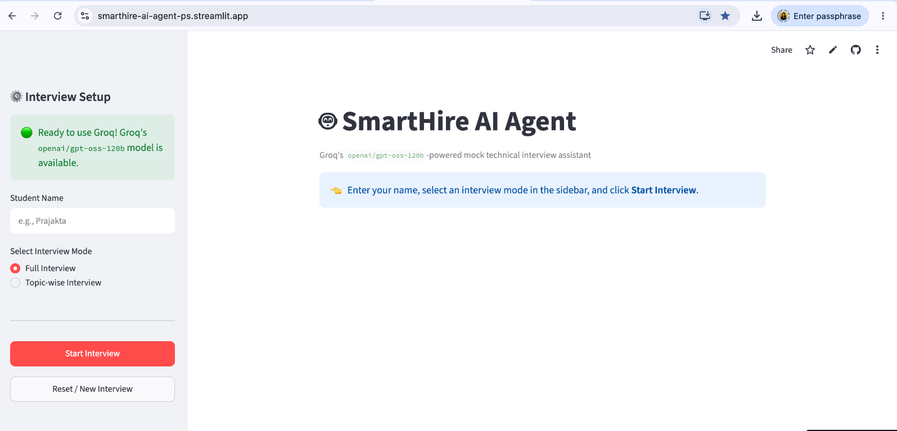
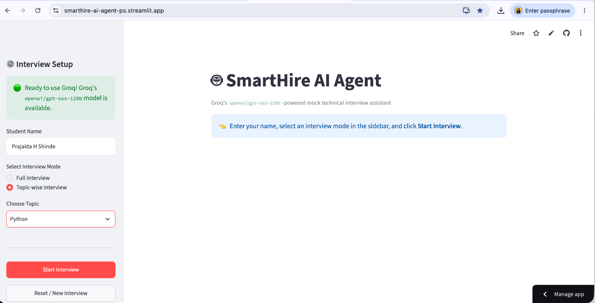
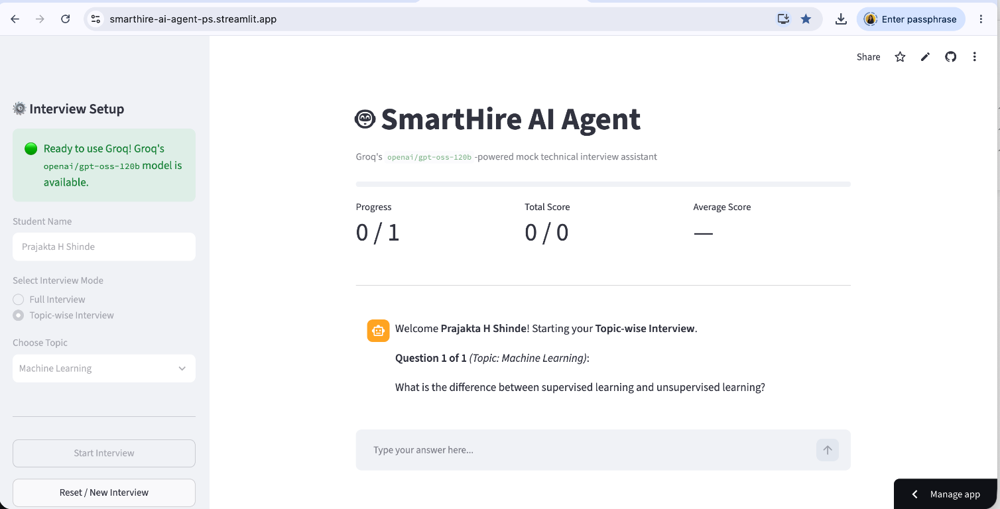
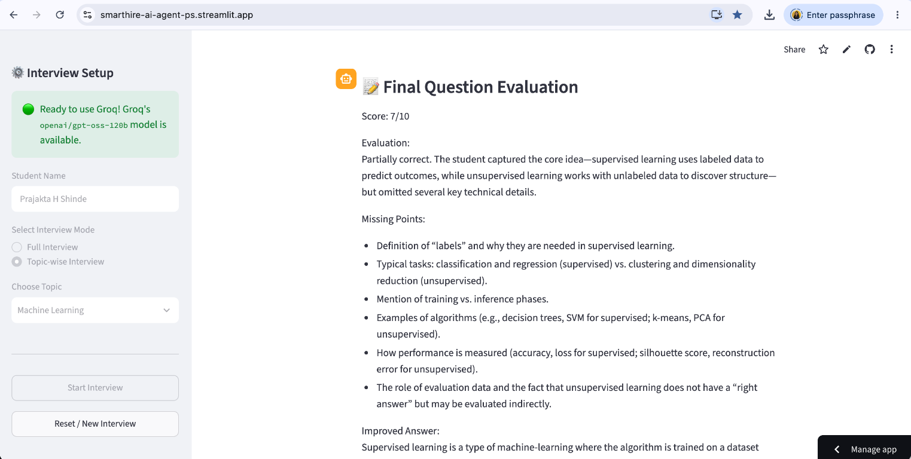
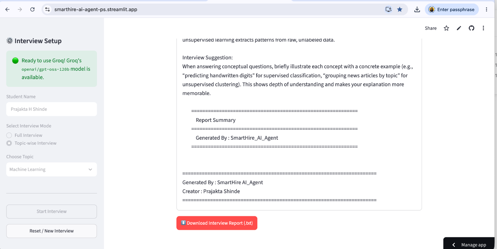

# SmartHire AI Agent

SmartHire AI Agent is an AI-powered mock technical interview application built with Python. It presents interview questions through a Streamlit chat interface, evaluates candidate answers with Groq's `openai/gpt-oss-120b` model, calculates interview scores, and saves a detailed text report.

The project demonstrates prompt engineering, LLM integration, answer evaluation, interview automation, interview history, and report generation.

## Features

- Streamlit-based interactive interview UI
- Full interview mode
- Topic-wise interview mode
- Live interview progress and score metrics
- Structured answer evaluation with:
  - Score out of 10
  - Evaluation
  - Missing points
  - Improved answer
  - Interview suggestion
- Final performance summary
- Question-wise interview report
- Downloadable and locally saved `.txt` reports
- Console-based interview interface through `main.py`

## Available Topics

The question bank in `questions.py` includes:

- Python
- Object-Oriented Programming (OOP)
- Machine Learning
- Deep Learning
- Transformer
- Large Language Models (LLM)
- Retrieval-Augmented Generation (RAG)
- AI Agents

## Tech Stack

- Python
- Streamlit
- Groq API
- `openai/gpt-oss-120b`
- `groq` and `requests` Python packages
- `python-dotenv`

## Project Structure

```text
SmartHire-AI-Agent/
├── app.py
├── main.py
├── interview_agent.py
├── llm_engine.py
├── questions.py
├── report_generator.py
├── requirements.txt
├── README.md
├── docs/
│   └── screenshots/
└── reports/
```

## File Overview

- `app.py` - Streamlit web application and chat interface
- `main.py` - Console-based application entry point
- `interview_agent.py` - Evaluates answers, maintains history, calculates scores, and creates reports
- `llm_engine.py` - Loads the Groq API key and communicates with the Groq model
- `questions.py` - Interview questions and topic definitions
- `report_generator.py` - Saves generated reports in the `reports/` directory
- `reports/` - Generated interview report files

## Prerequisites

- Python 3.10 or newer
- A Groq account and API key
- Internet access for Groq API requests

## Setup

1. Clone or download the repository:

```bash
git clone https://github.com/Prajakta6/SmartHire-AI-Agent.git
cd SmartHire-AI-Agent
```

2. Create and activate a virtual environment:

```bash
python -m venv .venv
source .venv/bin/activate
```

On Windows:

```powershell
python -m venv .venv
.venv\Scripts\activate
```

3. Install dependencies:

```bash
pip install -r requirements.txt
```

4. Create a `.env` file in the project root:

```text
GROQ_API_KEY=your_groq_api_key
```

Do not commit `.env` or expose your API key.

## Running the Streamlit App

**Live deployed app:** [https://smarthire-ai-agent-ps.streamlit.app/](https://smarthire-ai-agent-ps.streamlit.app/)

Start the web interface from the project root:

```bash
streamlit run app.py
```

Open the local URL shown by Streamlit, usually `http://localhost:8501`.

In the sidebar:

1. Enter your name.
2. Select full or topic-wise interview mode.
3. If using topic-wise mode, choose a topic.
4. Click **Start Interview**.
5. Answer each question in the chat input.
6. Review the evaluation and continue.
7. Download the final report from the completed interview view.

## Screenshots

### Application Home

The setup sidebar confirms Groq model availability and lets the user enter a name and choose an interview mode.



### Topic-wise Interview Setup

Topic-wise mode adds a topic selector and supports all topics in the question bank.



### Interview in Progress

The app displays live progress, total score, average score, the current question, and the chat input.



### AI Answer Evaluation

The Groq `openai/gpt-oss-120b` model provides a score, evaluation, missing points, improved answer, and interview suggestion.



### Final Report and Download

After the interview, the app provides a report preview and a text report download.



## Running the Console App

The text-only interface can be started with:

```bash
python main.py
```

The console menu provides:

```text
Select Interview Mode
1. Start Full Interview
2. Start Topic-wise Interview
3. Exit
```

## How It Works

1. The application creates a `MockInterviewAgent` for the candidate.
2. It builds a prompt containing the topic, question, candidate name, and answer.
3. `llm_engine.py` sends the prompt to Groq's `openai/gpt-oss-120b` model.
4. The agent extracts a numerical score from the response.
5. The score and complete answer history are stored in memory.
6. The application calculates the total and average score.
7. `report_generator.py` saves the final report as a timestamped `.txt` file.

## Report Output

Reports are saved automatically in the `reports/` directory. The filename format is:

```text
SmartHire_AI_Agent_<student_name>_Interview_Report_<dd_mm_yyyy_HH_MM_SS>.txt
```

Example:

```text
reports/SmartHire_AI_Agent_Prajakta_Shinde_-PS_Interview_Report_21_11_2026_16_49_24.txt
```

The Streamlit app also provides an in-page report preview and download button.

## Troubleshooting

### Groq API key not found

- Confirm that `.env` exists in the project root.
- Confirm it contains `GROQ_API_KEY=...`.
- Restart Streamlit or the console process after changing `.env`.

### Groq model unavailable

- Check your Groq API key and account access.
- Confirm that `openai/gpt-oss-120b` is available to your Groq account.
- Verify your internet connection.

### Missing Python package

Run:

```bash
pip install -r requirements.txt
```

### Report not found

- Confirm write permissions for the project directory.
- The application creates the `reports/` directory automatically if it does not exist.

## Author

Prajakta Shinde

## License

This project is provided for educational and demonstration purposes.
